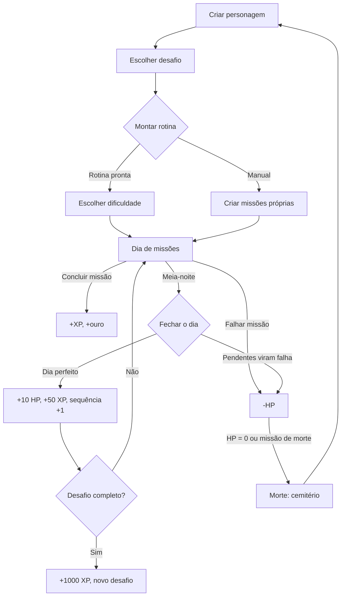
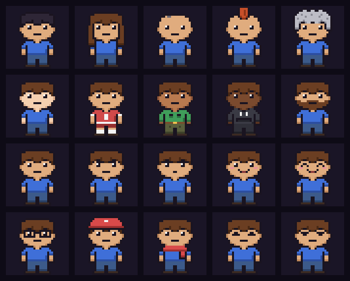
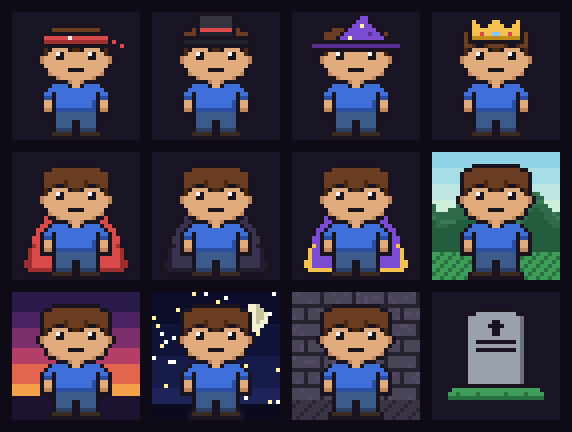

# RunFall


**Disciplina diária. Consequências reais.**

RunFall é um app de hábitos com mecânica de RPG *roguelike*. Você cria um personagem em pixel art, escolhe um desafio (de 7 dias até "sem fim") e cumpre missões da vida real todos os dias: beber água, treinar, estudar, dormir bem. Completar missões dá XP, ouro e níveis. Falhar tira HP. Se o HP zerar ou você falhar numa **missão de morte**, o personagem morre de vez: vai para o cemitério e o nome dele fica bloqueado para sempre.

Feito com **Expo SDK 58**, **React Native 0.88** e **TypeScript**. Roda em Android e iOS.

---

## Sumário

- [Como o jogo funciona](#como-o-jogo-funciona)
- [Regras](#regras)
- [Personagem e sprites](#personagem-e-sprites)
- [Loja de cosméticos](#loja-de-cosméticos)
- [Conquistas](#conquistas)
- [Telas](#telas)
- [Como rodar o projeto](#como-rodar-o-projeto)
- [Gerar o APK](#gerar-o-apk)
- [Arquitetura](#arquitetura)
- [Estrutura de pastas](#estrutura-de-pastas)
- [Roadmap](#roadmap)

---

## Como o jogo funciona



1. **Crie um personagem** escolhendo nome, gênero e aparência. Uma prévia em pixel art atualiza ao vivo.
2. **Escolha um desafio**: 7, 14, 21, 30, 50, 75, 100 ou 365 dias, ou *Hardcore* (sem fim).
3. **Monte a rotina**: use uma rotina pronta de acordo com a dificuldade ou crie suas próprias missões.
4. **Cumpra as missões do dia** marcando cada uma como *Concluir* ou *Falhar*.
5. **O dia fecha sozinho à meia-noite.** Tudo o que ficou pendente conta como falha, inclusive nos dias em que você não abriu o app.
6. Sobreviva até o fim do desafio, gaste o ouro na loja e comece o próximo.

---

## Regras

### Missões

Cada missão tem um nível que define recompensa e punição. Os valores abaixo valem para a dificuldade **Médio**.

| Nível | XP | Ouro | Se falhar |
|---|---|---|---|
| Simples | 20 | 5 | -10 HP |
| Média | 40 | 10 | -20 HP |
| Difícil | 70 | 15 | -35 HP |
| **Morte** | 100 | 25 | **morte imediata** |

### Dificuldades

A dificuldade multiplica o XP e o HP perdido e define o tamanho da rotina pronta.

| Dificuldade | XP | HP perdido | Missões por dia (rotina pronta) |
|---|---|---|---|
| Fácil | x0,75 | x0,5 | 4 (2 simples, 1 média, 1 de morte) |
| Médio | x1 | x1 | 6 (3 simples, 2 médias, 1 de morte) |
| Difícil | x1,3 | x1,4 | 9 (4 simples, 3 médias, 1 difícil, 1 de morte) |
| Hardcore | x2 | x1,75 | 11 (5 simples, 3 médias, 2 difíceis, 1 de morte) |

A rotina manual usa a dificuldade **Médio**. O ouro não é afetado pela dificuldade.

### HP, fim do dia e sequência

- O personagem começa com **100 HP**.
- À meia-noite (horário local do aparelho) o dia é encerrado:
  - as missões pendentes **falham** e tiram HP normalmente;
  - **dia perfeito** (nenhuma falha): **+10 HP**, **+50 XP** e a sequência aumenta;
  - qualquer falha **zera a sequência**;
  - a cada **7 dias perfeitos seguidos**: **+250 XP** de bônus.
- **Dias sem abrir o app também contam.** Ao voltar, o app processa cada dia perdido como se todas as missões tivessem falhado.
- Concluir um desafio dá **+1000 XP**. As missões param até você começar um novo desafio.

### Níveis

| Nível | XP total |
|---|---|
| 2 | 100 |
| 3 | 250 |
| 4 | 450 |
| 5 | 700 |
| 6 em diante | nível² × 50 (ex.: nível 10 = 5.000 XP) |

### Morte

O personagem morre quando o **HP chega a 0** ou quando ele **falha numa missão de morte**. Falhar uma missão de morte pede confirmação. Ao morrer:

- o personagem vai para o **cemitério**, com nível, dias vividos e causa da morte;
- o **nome fica bloqueado** para sempre;
- o **guarda-roupa da loja é mantido** para o próximo personagem.

---

## Personagem e sprites



O personagem é desenhado em **pixel art 32×32 gerada por código**. O projeto não usa nenhum arquivo de imagem para ele. Cada sprite é montada em camadas, de trás para frente:

`fundo → capa → corpo → roupa → barba → olhos → expressão → cabelo → acessório → chapéu`

| Opção | Valores |
|---|---|
| Cabelo | Curto, Longo, Careca, Moicano, Cacheado |
| Cor do cabelo | Preto, Castanho, Loiro, Ruivo, Grisalho |
| Barba | Com ou sem |
| Tom de pele | Clara, Média, Morena, Escura |
| Roupa | Casual, Esportivo, Militar, Urbano |
| Cor da roupa | Cinza, Azul, Verde, Vermelho, Preto |
| Olhos | Redondos, Amendoados, Caídos, Fechados |
| Acessório | Nenhum, Óculos, Boné, Cachecol |
| Expressão | Neutra, Determinada, Séria, Confiante |

Na tela de criação há um botão **Aleatório**. O personagem dá um pulinho animado, e no cemitério cada herói aparece como era em vida.

---

## Loja de cosméticos



O ouro ganho nas missões compra cosméticos. Na loja você pode **provar qualquer item antes de comprar**. Os cosméticos pertencem ao **jogador**, não ao personagem, então continuam com você depois de uma morte.

| Item | Tipo | Preço |
|---|---|---|
| Bandana | Chapéu | 80 |
| Cartola | Chapéu | 150 |
| Chapéu de mago | Chapéu | 250 |
| Coroa | Chapéu | 500 |
| Capa vermelha | Capa | 120 |
| Capa sombria | Capa | 200 |
| Capa real | Capa | 400 |
| Floresta | Fundo | 60 |
| Pôr do sol | Fundo | 100 |
| Noite estrelada | Fundo | 150 |
| Masmorra | Fundo | 200 |

Um dia perfeito no Médio rende cerca de **60 de ouro**.

---

## Conquistas

| Conquista | Como desbloquear |
|---|---|
| Primeiro personagem criado | Crie seu primeiro personagem |
| Primeira semana | Sobreviva 7 dias |
| 30 dias vivos | Sobreviva 30 dias |
| 100 missões | Complete 100 missões |
| Nível 10 / 25 / 50 | Alcance o nível |
| Hardcore 30 dias | Sobreviva 30 dias no Hardcore |
| Hardcore 100 dias | Sobreviva 100 dias no Hardcore |
| Nenhuma missão perdida | Sobreviva 7 dias sem falhar nenhuma missão |
| Primeiro desafio concluído | Complete um desafio (**+500 XP**) |
| Primeira morte | Perca seu primeiro personagem |
| 10 personagens mortos | Perca 10 personagens |

---

## Telas

| Tela | O que faz |
|---|---|
| **Início** | Logo, personagem atual, continuar ou criar personagem e acesso ao cemitério |
| **Criar personagem** | Nome, gênero e aparência com prévia ao vivo |
| **Desafio / Rotina / Dificuldade** | Configuração do desafio e da rotina de missões |
| **Painel** | Avatar, ouro, HP, XP, progresso do desafio, missões do dia e menu |
| **Missões** | Missões de hoje com recompensas e punições, e edição da rotina |
| **Loja** | Chapéus, capas e fundos com prova antes da compra |
| **Personagem** | Avatar grande, itens equipados e aparência |
| **Evolução** | Nível, XP para os próximos níveis e bônus |
| **Calendário** | Um quadrado por dia: verde para dias perfeitos, vermelho para dias com muito dano |
| **Conquistas** | Lista com as datas de desbloqueio |
| **Histórico** | Registro de cada dia encerrado |
| **Cemitério** | Todos os personagens mortos |
| **Fim de jogo** | Lápide, estatísticas e um novo começo |
| **Ajustes** | Opções futuras e, em desenvolvimento, as ferramentas de teste |

---

## Como rodar o projeto

**Pré-requisitos:** Node.js 22.13+ ou 24.3+ e um aparelho Android ou iOS (ou emulador).

```bash
npm install
npx expo start
```

Para gerar e instalar um build de desenvolvimento nativo (precisa do Android SDK e do JDK):

```bash
npx expo run:android
```

### Ferramentas de teste

Em modo de desenvolvimento, a tela **Ajustes** tem botões que **adiantam o relógio do app** em 1, 7 ou N dias. Assim dá para testar o fechamento de dias, as sequências, o fim do desafio e a morte sem esperar a meia-noite. Elas não aparecem no APK de release.

### Verificações

```bash
npx tsc --noEmit          # tipos
npx expo-doctor@latest    # saúde do projeto Expo
```

---

## Gerar o APK

O APK é compilado na nuvem pelo **EAS Build**. O perfil `preview` do [eas.json](eas.json) gera um `.apk` instalável.

```bash
npx eas-cli login
npx eas-cli build -p android --profile preview
```

Ao terminar, o EAS mostra um link e um QR code para baixar o APK. Para instalar, permita "instalar apps desconhecidos" no Android.

> O EAS instala as dependências com `npm ci`, que é mais rígido que o `npm install`. Se o build falhar em *Install dependencies*, rode `npm ci` localmente para reproduzir o erro.

---

## Arquitetura

### Estado e persistência

O estado fica em stores **Zustand**, salvos no aparelho com **AsyncStorage**. Não há servidor nem conta.

| Store | Responsabilidade |
|---|---|
| [`characterStore`](src/store/characterStore.ts) | Personagem vivo, missões, fechamento dos dias, XP, ouro e morte |
| [`cemeteryStore`](src/store/cemeteryStore.ts) | Personagens mortos e nomes bloqueados |
| [`cosmeticStore`](src/store/cosmeticStore.ts) | Cosméticos comprados e equipados (do jogador) |
| [`achievementStore`](src/store/achievementStore.ts) | Conquistas, verificadas a cada mudança nos outros stores |

O `characterStore` tem migração de versão: personagens salvos em versões antigas do app são atualizados automaticamente.

### Ciclo do dia

As missões de cada dia são geradas a partir dos **modelos da rotina** (`missionTemplates`). A função `syncDays()`:

1. compara o dia das missões atuais (`lastMissionDate`) com hoje;
2. para cada dia que passou, falha as pendentes, aplica HP, sequência e bônus e registra o dia no histórico;
3. gera as missões do dia seguinte e repete até chegar em hoje.

Ela roda ao abrir o app, ao voltar para ele e a cada 30 segundos, o que detecta a meia-noite. As datas usam chaves `AAAA-MM-DD` no **horário local**. Se o personagem morre, o layout redireciona para a tela de fim de jogo.

### Sprites

Ficam em [`src/sprites/`](src/sprites/):

- [`parts.ts`](src/sprites/parts.ts): cada camada é uma grade de texto de 32 colunas. `.` é transparente e cada letra é uma cor da paleta. As letras `S/H/O/P` são trocadas pela pele, cabelo, roupa e calça do personagem.
- [`palette.ts`](src/sprites/palette.ts): cores de pele, cabelo e roupa, mais a paleta fixa.
- [`backgrounds.ts`](src/sprites/backgrounds.ts): fundos gerados por código.
- [`compose.ts`](src/sprites/compose.ts): empilha as camadas numa grade de cores 32×32.

O componente [`PixelSprite`](src/components/PixelSprite.tsx) desenha a grade com `View`s, juntando pixels vizinhos da mesma cor (cerca de 200 views por sprite em vez de 1024). Isso dispensa bibliotecas nativas de imagem ou SVG.

**Para adicionar um cosmético:** desenhe a camada em `parts.ts` (em `HATS` ou `CAPES`) ou crie um fundo em `backgrounds.ts`, depois registre nome, tipo e preço em [`constants/cosmetics.ts`](src/constants/cosmetics.ts).

### Visual

- Fonte pixel **Press Start 2P** para títulos, números e botões, e fonte do sistema para textos longos.
- Tema escuro com as cores em [`src/theme/colors.ts`](src/theme/colors.ts): verde, azul, laranja e vermelho identificam os níveis das missões.
- Botões em estilo fliperama, com uma borda inferior que "afunda" ao toque.

---

## Estrutura de pastas

```
app/                      Telas (expo-router: cada arquivo é uma rota)
  _layout.tsx             Carrega a fonte e define a navegação
  index.tsx               Splash: decide para onde ir
  home.tsx                Tela inicial
  create-character.tsx    Criação de personagem
  select-*.tsx            Desafio, modo de rotina e dificuldade
  manual-missions.tsx     Rotina manual
  death.tsx               Fim de jogo
  cemetery.tsx            Cemitério
  (app)/                  Telas que exigem personagem vivo
    _layout.tsx           Sincroniza os dias e redireciona na morte
    dashboard.tsx, missions.tsx, shop.tsx, character.tsx,
    evolution.tsx, calendar.tsx, achievements.tsx,
    history.tsx, settings.tsx
src/
  components/             Avatar, PixelSprite, Button, Card, ProgressBar...
  constants/              Regras: XP, HP, dificuldades, desafios, conquistas, loja
  sprites/                Pixel art em código
  store/                  Stores Zustand
  theme/                  Cores, espaçamento e tipografia
  types/                  Modelos de dados
  utils/date.ts           Datas no horário local
docs/images/              Imagens deste README (geradas pelas próprias sprites)
```

---

## Roadmap

- [ ] Notificações diárias lembrando das missões
- [ ] Sons e vibração
- [ ] Exportar e importar dados
- [ ] Recompensas por nível (títulos, molduras)
- [ ] Mais cosméticos e animações do personagem
